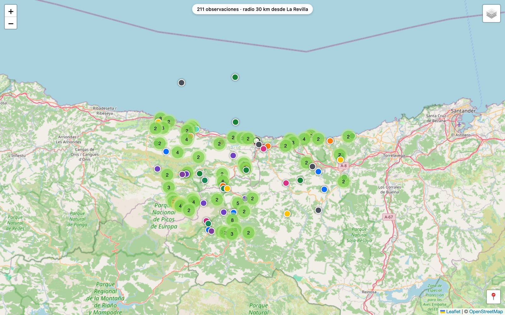

# Naturaleza Cantabria

Interactive maps of wildlife and plant sightings around La Revilla (San Vicente de la Barquera, Cantabria), built from the public [iNaturalist](https://www.inaturalist.org) API. The site itself is in Spanish.

**Live:** <https://hector14mv.github.io/naturaleza-cantabria/>

## What's inside

- **`index.html`**: landing page with links to the maps.
- **`mapa-observaciones.html`**: the main map. 96 standout May species within 30 km of La Revilla: Cantabrian endemics, orchids, butterflies, reptiles and amphibians, mammals. Markers are coloured by group and clustered when they overlap, and a "Mi ubicación" button follows your position live.
- **`mapa-ibio.html`**: every sighting of any group within 5 km of the Antenas de Ibio.
- **`observaciones.html`** and **`observaciones-cercanas.md`**: a table of the 96 species with their number of sightings and the latest one; each row links to Google Maps.

Plain HTML, CSS and JavaScript with [Leaflet](https://leafletjs.com) and OpenStreetMap tiles. No build step.

## Privacy

Sightings by `@hectormoyano` and `@sergiovelez` are left out on purpose: the maps show what **other** people have recorded, to complement our own observations rather than repeat them.

## Data licence

Data comes from iNaturalist and keeps its original licences (mostly CC BY-NC). Map tiles © OpenStreetMap contributors.
